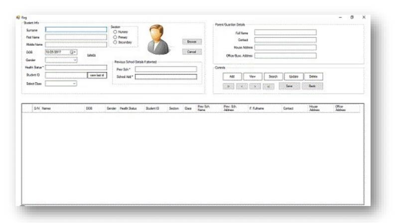
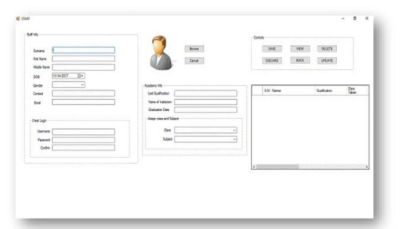
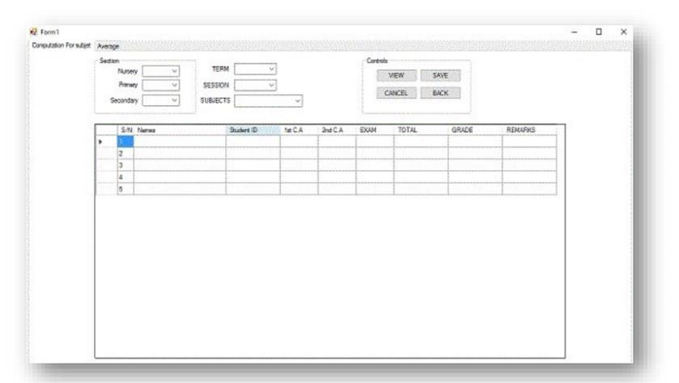
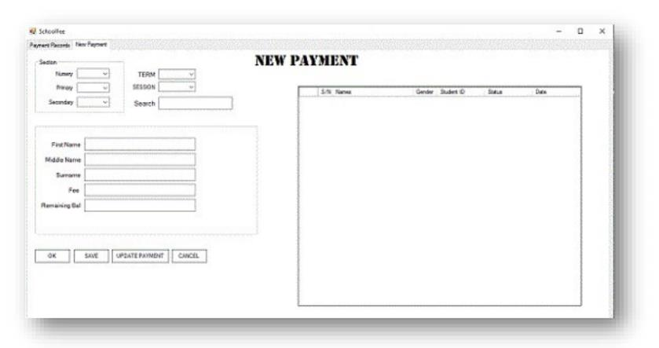

# School Management System — Fatima Academy, Nguru

A desktop School Management System (SMS) built in C# with a Microsoft Access database, designed to replace paper records and manual result computation at Fatima Academy, Nguru, Yobe State, Nigeria.

**Preprint DOI:** [10.5281/zenodo.23424238](https://doi.org/10.5281/zenodo.23424238)

## Abstract

Most primary and secondary schools in Nigeria still keep student and staff records on paper. These records are vulnerable to loss, damage and unauthorised access, and manual computation of end-of-term results is slow and error-prone. This project presents the design and implementation of a School Management System for Fatima Academy, Nguru. The system supports staff and student registration, school fee records, and automatic computation of subject totals, grades and averages, with role-based login access for administrators and teaching staff. Requirements were gathered through interviews with school management and analysis of existing documents. The system was developed using throwaway prototyping and modelled with UML. Testing included unit, integration, functional, security and system testing, followed by user acceptance testing with six school staff members (see the technical report for results).

## Features Implemented

| Module | Users | Functions |
|---|---|---|
| Login & Account Management | Admin, Staff | Login, change password, recover password |
| Student Registration | Admin | Add, view, search, update, delete student records |
| Staff Registration | Admin | Add, view, search, update, delete staff records; assign class and subject |
| Result Computation | Staff | Enter 1st CA, 2nd CA and exam scores; system computes total, grade, remark and average |
| School Fees | Admin | Record and update payments, track balance per term |

**Assessment weighting:** Continuous Assessment 30% + Examination 70%

## Screenshots

| Student Registration | Staff Registration |
|---|---|
|  |  |

| Result Computation | School Fees |
|---|---|
|  |  |

## Not Implemented (Future Work)

- Report generation and result printing
- Excel export (backup)
- Automatic student promotion/demotion

## Technology Stack

- C# (Windows Forms), .NET Framework
- Microsoft Access via OLEDB (`Microsoft.ACE.OLEDB.12.0`)
- Microsoft Visual Studio
- UML modelling; throwaway prototyping

## Setup

**Prerequisites:** Windows, Visual Studio (2015+), Microsoft Access Database Engine (ACE OLEDB 12.0)

1. Clone the repo: `git clone https://github.com/<your-username>/sms-fatima-academy.git`
2. Open the solution in Visual Studio.
3. Place `database/school_sample.accdb` in the application's startup directory (`Application.StartupPath`).
4. Build and run.

The sample database contains no real accounts. Create an administrator record manually in the `login` table.

## Database Tables

- `login` — usernames, passwords, roles
- `students` — bio-data, class, section, guardian details
- `staff` — bio-data, qualifications, assigned class and subject
- `assessments` — CA and exam scores per student, subject, term
- `fees` — payments and balances per term

## Testing

Unit, integration, functional, security, system, black-box and user acceptance testing (six school staff). No timing measurements were recorded, so claimed benefits rest on user feedback, not measured performance.

## Known Limitations

- **Small scale:** Access is file-based; larger schools need SQL Server or MySQL.
- **No web access:** desktop only.
- **SQL injection risk:** queries are built by string concatenation, not parameters.
- **Password handling:** a salted SHA-1 routine exists in `FormLogin.cs` but is not wired into login; passwords are compared in plain text.
- **Small evaluation:** six users at one school.

## Security Notes

Academic project, published for reference and learning. **Not production-ready.** Anyone reusing it should:

1. Use parameterised queries (`OleDbParameter`).
2. Hash passwords with PBKDF2, bcrypt or Argon2.
3. Restrict access to the database file.
4. Keep regular backups.

## Citation

```bibtex
@misc{abubakar2026sms,
  author    = {Abubakar, Muhammad Ali and Trader, Mubarak Usman and Garba, Adamu Abdullahi},
  title     = {School Management System: Design and Implementation for Fatima Academy, Nguru},
  year      = {2026},
  publisher = {Zenodo},
  doi       = {10.5281/zenodo.23424238},
  url       = {https://doi.org/10.5281/zenodo.23424238}
}
```

## License

- Source code: MIT (see `LICENSE`)
- Documentation and diagrams: CC BY 4.0

## Acknowledgements

Supervisor: Mal. Adamu Abdullahi Garba, Department of Computer Science,   Yobe State University, Damaturu, Nigeria.

The management and staff of Fatima Academy, Nguru, for their participation in requirements gathering and user acceptance testing.
